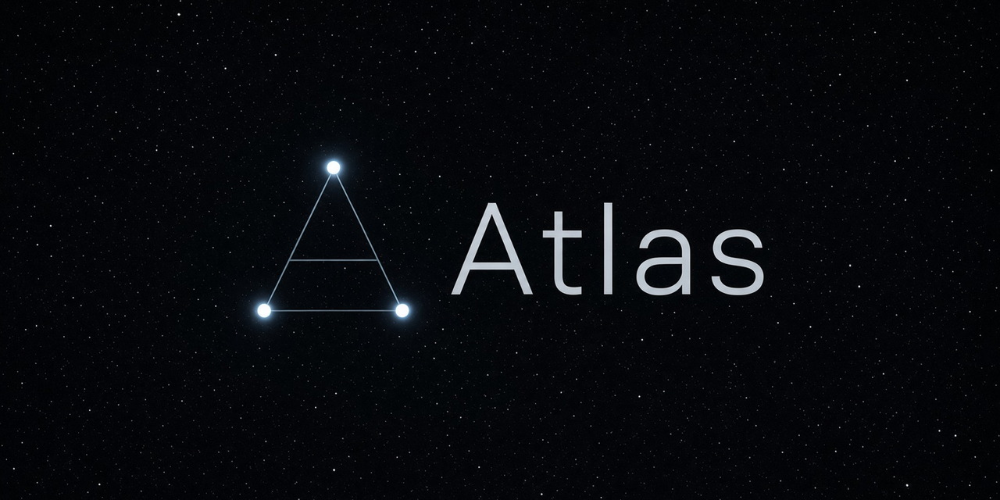

# Atlas



Atlas is a distributed knowledge network built from Git repositories and Markdown, with a schema and CLI that help agents keep knowledge stores structured and connected.

## Why / what this is not

Atlas gives working knowledge durable, linked pages that can be shared across stores and reviewed as Git history. It is a storage and knowledge-organization substrate, not a system of record, a closed ontology, or an automatic author of claims. Agents create and maintain content; Atlas checks it against the store's contract.

## Capabilities

- **Store and connect knowledge:** use Git-backed stores, organize pages into clusters, and link across stores with `atlas://`.
- **Check structure:** `atlas compile` validates the store contract, frontmatter, and required links.
- **Recall knowledge:** search uses `grep` by default; `atlas:ranked` enables FTS5 ranking, while `atlas:tgrep` is an advanced, limited option.
- **Work with knowledge:** initialize stores, remember experiences and decisions, manage work hubs, research landscapes, and install schema overlays.

Atlas includes a base schema that can be adapted to a use case. It does not prescribe a single Semantic Knowledge Organisation.

## Modules

| Module | What it does |
| --- | --- |
| Getting started | Explain first-use purpose, prerequisites, the shortest useful journey, and storage choices. |
| Help | Explain installed modules without running them. |

## Install

```bash
apm marketplace add sergio-sisternes-epam/atlas-marketplace --name atlas
apm install atlas@atlas
```

## Use

After installation, invoke the skill in an agent session:

- `/atlas How can I get started?`
- `/atlas Recall what we know about <topic> from the project Atlas.`
- `/atlas Remember this decision and its source: <decision and source>.`

Atlas uses guided paths for operations such as recall, remember, schema changes, and store migration. See [`SKILL.md`](SKILL.md) for the runtime contract and path rules.

## Prerequisites

Use the APM CLI to install the package. Its manifest declares the Python dependencies `jsonschema>=4.0` and `click>=8.0`.

## Related

- [Atlas marketplace](https://github.com/sergio-sisternes-epam/atlas-marketplace) — package catalog.
- [`okf`](https://github.com/sergio-sisternes-epam/okf) — format authority and separate dependency.
- [`atlas-atlas`](https://github.com/sergio-sisternes-epam/atlas-atlas) — companion process-memory store.
- [`discuss`](https://github.com/sergio-sisternes-epam/discuss) — optional companion discussion skill.
- [`SKILL.md`](SKILL.md) — runtime behavior and module paths.

## Migrate / upgrade

Store relocation and rehosting guidance is in [`references/paths/migrate.md`](references/paths/migrate.md). Document-era or pre-beta memory migrations are covered by [`references/paths/memory-migrate.md`](references/paths/memory-migrate.md).

## Contributing

See [`CONTRIBUTING.md`](CONTRIBUTING.md) for setup, validation, and release guidance. Report vulnerabilities through a [private GitHub security advisory](https://github.com/sergio-sisternes-epam/atlas/security/advisories/new).

## License

Atlas is licensed under the [Apache License 2.0](LICENSE), Copyright 2026 Sergio Sisternes. The separately distributed `okf` dependency remains under its own Apache-2.0 license and notice.
